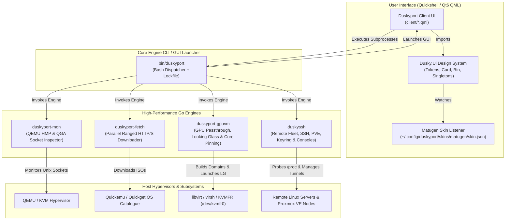

# Duskyport Architecture & System Design

Duskyport is engineered as a modular, decoupled fleet management and virtualization platform for Linux, designed specifically for **Dusky OS** and **Arch Linux** desktop environments.

---

## 1. Component Overview

### A. Quickshell Frontend (`client/`)
The graphical user interface is built on **Quickshell**, a modern Qt6/QML Wayland-native shell runtime.
- **`App.qml`**: Main window orchestrator, deep-link handler, status banner manager, and tab switcher (`dashboard`, `machines`, `remotes`, `passthrough`, `consoles`).
- **`Dashboard.qml`**: Unified overview showing machine counts, live CPU/RAM utilization, remote server latency badges, and quick-action launcher cards.
- **`Machines.qml`**: Local VM library, snapshot manager, instant cloud-init deployer, and Quickget operating system catalogue browser.
- **`Remotes.qml`**: Fleet manager for SSH hosts, live health monitoring (`/proc/stat`, `/proc/meminfo`), background port forwards, and Proxmox VE cluster management.
- **`Passthrough.qml`**: Dedicated Looking Glass B6 control panel, dGPU binding states, and host core pinning plan visualizer.
- **`Consoles.qml`**: Serial (`picocom`), telnet (`inetutils`), RDP (`freerdp`), and VNC (`tigervnc`) connection berth manager.

### B. Design System Runtime (`Dusky.Ui`)
All visual elements are drawn using the unified `Dusky.Ui` component library:
- **`Tokens.qml`**: Reactive singleton that watches `~/.config/duskyport/skins/matugen/skin.json` and automatically retints every UI component on wallpaper or theme change.
- **`Card.qml`, `Btn.qml`, `Field.qml`, `Dialog.qml`**: Consistent, hardware-accelerated interactive components adhering to the Material 3 design spec.
- **`UiPreferences.qml`**: Dusky brand mark provider (`"港"` for harbour/port).

### C. The Core Dispatcher (`bin/duskyport`)
- Provides both CLI verbs (`caps`, `list`, `instant`, `import`, `snapshot`, `resize`, `mon`, `lg`) and launches the GUI when invoked without arguments or with `--gui`.
- Uses an atomic flock (`/tmp/duskyport.lock`) to refocus an existing instance if one is already running rather than spawning duplicate windows.

### D. Standalone Go Helper Engines (`cmd/`)
1. **`duskyport-fetch`**: Multi-threaded parallel ranged downloader optimized for downloading multi-gigabyte ISOs and cloud-init images quickly and reliably.
2. **`duskyport-mon`**: Inspects QEMU sockets, communicates with QEMU Guest Agent (QGA) and HMP (Human Monitor Protocol) to fetch real-time guest memory, disk, and CPU usage.
3. **`duskyssh`**:
   - Parses `~/.ssh/config` safely without corrupting comments or order.
   - Performs agentless `/proc` health probes over SSH channels.
   - Integrates with Proxmox VE REST API to monitor and control cluster nodes and guest VMs.
   - Stores passwords and secrets securely using the FreeDesktop Secret Service specification (login keyring).
4. **`duskyport-gpuvm`**:
   - Independent GPU passthrough manager (previously coupled to the monolithic hub).
   - Generates libvirt domain XMLs with `/dev/kvmfr0` IVSHMEM device nodes for Looking Glass B6.
   - Computes intelligent CPU core pinning plans that reserve core 0 for the host OS to eliminate micro-stuttering during gameplay.
